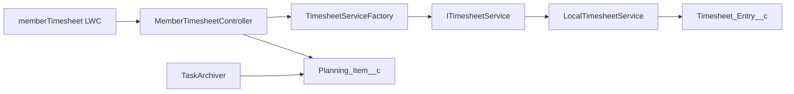

# Member timesheet

A Salesforce Lightning Web Component for recording time against assigned tasks. This is a sanitised public copy of a timesheet app used by 25 staff in production, written against custom development-org objects rather than the production timesheet schema.

- **UI:** a week of day tabs beside pending work; members create, complete and reopen tasks and view past weeks. Time entries stay separate records, even for the same task and day. Durations run in 15-minute steps from 15 minutes to 12 hours.
- **Apex:** the controller checks ownership and limits time-entry changes to the current week.
- **Design:** `ITimesheetService` separates time-entry storage from controller rules, with a local implementation behind a factory.
- **Tests:** three Apex test classes.



## Run in a development org

Salesforce CLI and a development org (replace `YOUR_DEV_ORG`):

```sh
sf project deploy start --source-dir force-app --target-org YOUR_DEV_ORG
sf org assign permset --name SPT_Team_Member --target-org YOUR_DEV_ORG
sf apex run test --test-level RunLocalTests --target-org YOUR_DEV_ORG --wait 10
```

Then open the Member Timesheet tab. The optional `scripts/apex/seed.apex` deletes existing planning items before inserting ten examples, so use it only in a disposable org.

## Limits

Integration with a real timesheet schema is unfinished; the included service targets development-org objects. This repository contains the member view only; there is no assignment interface or scheduled archive job (run `scripts/apex/archive.apex` manually). See [DECISIONS.md](DECISIONS.md).

[MIT licence](LICENSE)
